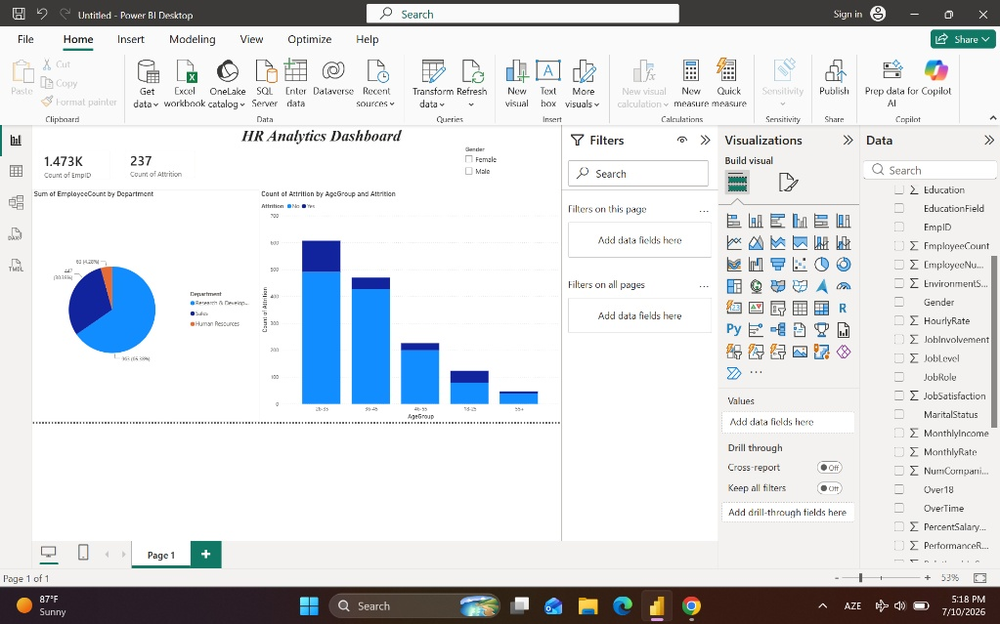

# HR Analytics Dashboard - Employee Attrition Project

## 📊 Project Overview
This Power BI dashboard was developed to analyze employee data and understand the key drivers behind employee attrition (turnover). The goal is to provide data-driven insights for HR teams to improve employee retention strategies.

## 🚀 Key Insights from the Dataset
* **Total Workforce:** The company manages a total of **1,473 employees**.
* **Attrition Volume:** A total of **237 employees** have left the organization.
* **Critical Age Group:** Employees aged **26-35** represent the highest attrition rate (**116 dropouts**), signaling a potential retention issue among young professionals.
* **Department Breakdown:** The *Research & Development* department holds the largest share of the workforce, followed by *Sales* and *Human Resources*.

## 🛠️ Tech Stack & Skills Used
* **Data Cleaning & ETL:** Power Query (Removed duplicates, handled null values, and optimized data types).
* **Data Visualization:** Power BI Desktop (Donut charts, Stacked Column charts, Slicers, and KPI Cards).
* **Interactivity:** Implemented dynamic filtering by *Gender* and cross-filtering across visuals for deep-dive analysis.

## 📸 Dashboard Preview

## 📁 Project Structure
* `HR_Analytics_Dashboard.pbix` - The main Power BI project file.
* `HR_Analytics.csv` - The raw dataset used for this analysis.
